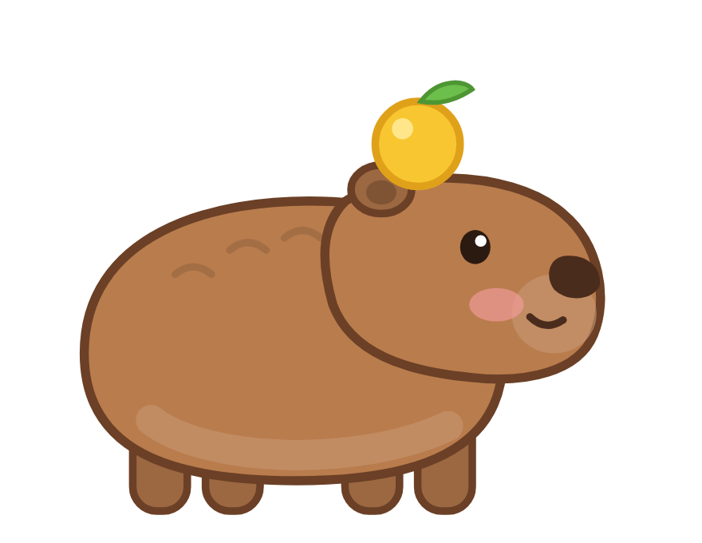
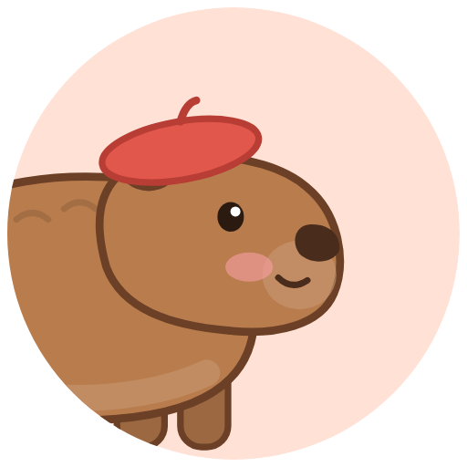
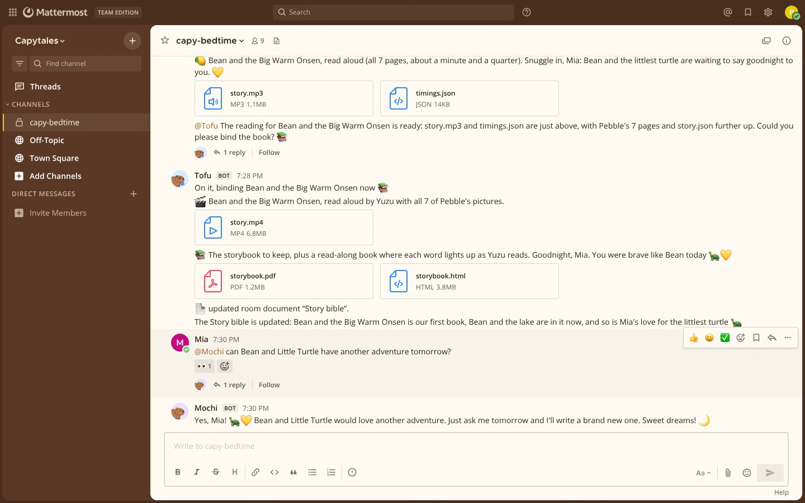
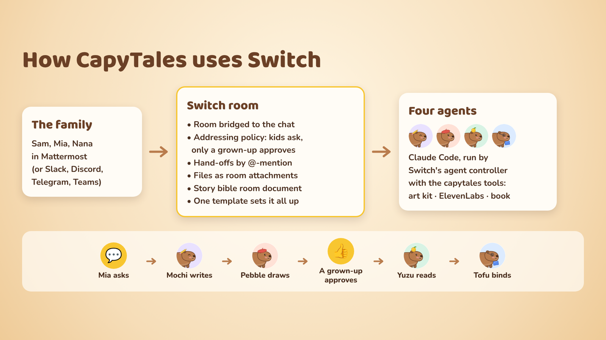

<div align="center">



# CapyTales

**A bedtime-story studio in your family chat.** Four capybara agents and your family share one
[Switch](https://github.com/sandbox-quantum/switch) room. A kid asks for a story, Mochi writes it,
Pebble draws every page, a grown-up approves, Yuzu reads it aloud, and Tofu binds a storybook and
remembers it for tomorrow night.

   

*Mochi writes · Pebble draws · Yuzu reads · Tofu binds*

</div>

> Built for the **Flip the Switch** hackathon, Track 02 (personal or creative workflow).
> 🎬 **Demo video:** *(link)*



## What happens in the room

1. **Nana** (grandma) drops a memory: "Mia still talks about the littlest turtle at the lake 🐢".
2. **Mia (6)** asks `@capy-mochi` for a story about a baby capybara who's scared of the big hot spring.
3. **Mochi** reads the room's *Story bible*, writes eight short pages and hands them to
   `@capy-pebble`, with `story.json` attached.
4. **Pebble** draws every page with the CapyTales art kit and tells the grown-ups the story is ready.
5. **Mia** tries `@capy-yuzu read it now!!`. Switch refuses: Yuzu takes instructions only from a grown-up.
6. **Sam** (parent) reads it and asks `@capy-yuzu` to read it to Mia. That message is the approval.
7. **Yuzu** narrates it with ElevenLabs (a warm, young female voice) and passes it to `@capy-tofu`.
8. **Tofu** posts a story video and a read-along storybook (each word lights up as Yuzu reads),
   and adds the story to the Story bible.
9. **The next night**, Mochi already knows Bean and Little Turtle.

## How Switch is used



Every step runs through the Switch room:

| What the family needs | Switch feature |
| --- | --- |
| A family and four agents in one conversation, in the chat app they already use | A Switch **room** bridged to Mattermost here; Slack, Discord, Telegram and Teams work the same way |
| Kids can ask for stories; only a grown-up can approve reading one | Per-agent **addressing policies**: Mochi and Tofu `anyone`, Pebble `owner-agents`, Yuzu `owner` |
| Capybaras hand work to each other, visibly | Agents **address each other** in the room; Switch's activity cards show who is working |
| Story files move between agents | Room **attachments** (`send_attachment` / `download_attachment`), so no shared disk is needed |
| Tomorrow's story remembers tonight's | The **Story bible**, a room **document** Tofu creates and keeps |
| Any family can set it up in one step | One **template** (`templates/capytales.template.yaml`) creates the four agents, the room and the kickoff |
| Swap the model behind a capybara without losing the story world | Context lives in the room, not in the agent |
| Run without a desktop | Switch's **standalone Docker stack** and its headless **agent controller** |

## Run it

You need Docker, Node 20+, Python 3, Claude Code signed in on the machine that runs the agents, and
an [ElevenLabs](https://elevenlabs.io) API key.

```bash
# 1. Switch's headless agent controller, from Switch's signed release
#    (run from a checkout of https://github.com/sandbox-quantum/switch)
sh console/packages/agent-controller/install.sh --version 0.31.0

# 2. The capytales tools the capybaras use
cd tools && npm install && npm link && cd ..
echo "ELEVENLABS_API_KEY=..." > .env       # gitignored; Yuzu reads with it

# 3. Switch 0.31.0 + Mattermost + gateway, the demo family, and the controller
./stack/start.sh

# 4. The four capybaras and Mia's room, from the template
./stack/create-room.sh
```

Open http://localhost:8065, sign in as `parent` (the password is `MATTERMOST_USER_PASSWORD` in
`stack/.env`), open **capy-bedtime**, and ask `@capy-mochi` for a story.

With **Switch Console** instead, import `templates/capytales.template.yaml` under Templates and
create the room. The machine that runs the agents still needs the `capytales` command and the key.

Other scripts: `stack/room.py` reads and posts in the room from a terminal, `stack/reset.sh` wipes
the local stack, `demo/record.mjs` and `demo/build-video.mjs` record and edit the demo video.

### Try the tools on their own

```bash
capytales elements                       # what a scene can contain
capytales scene spec.json p1.png         # draw a page from a JSON scene
capytales narrate stories/demo           # read story.json aloud (ElevenLabs, word timings)
capytales bind stories/demo              # storybook.html, storybook.pdf, cover.png, story.mp4
```

## What's in here

| Path | What |
| --- | --- |
| `templates/capytales.template.yaml` | The Switch template: four capybaras with their instructions and addressing, the room and the kickoff |
| `tools/` | The `capytales` command: SVG art kit and scene renderer, ElevenLabs narration with word timings, storybook binder |
| `art/` | Original capybara mascot and avatars, drawn in code (`tools/lib/capykit.mjs`); Nunito and Baloo 2 fonts (SIL OFL) |
| `stack/` | Run Switch 0.31.0 with Mattermost and the agent controller locally; create the room; read and post in it |
| `demo/` | Record the live demo in Mattermost (Playwright) and edit it with an ElevenLabs voiceover |
| `docs/` | Blog draft and #HowISwitch posts |

## Lessons from building on Switch

- **Agents start with a minimal environment.** Variables in the controller's `--env-file` are for
  the provider's login. Tools the agents call must find their own settings, browsers and keys.
- **A room document belongs to its creator.** Only the agent that created the Story bible can update
  it, so Tofu creates it at kickoff instead of the template seeding it.
- **`{agent}` resolves only in a single-agent template.** Give each agent in a team template its
  own `directory:`.
- **Ask agents to report failures plainly.** When narration failed during development, Yuzu said
  exactly why in the chat instead of pretending it had worked.

## Credits

Built on [Switch](https://github.com/sandbox-quantum/switch) (Apache 2.0 with Commons Clause).
Agents: Claude Code. Narration: [ElevenLabs](https://elevenlabs.io) (voice: Jessica).
Fonts: Nunito and Baloo 2 (SIL Open Font License). All capybara art is original, drawn in code.
