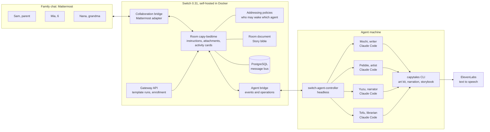
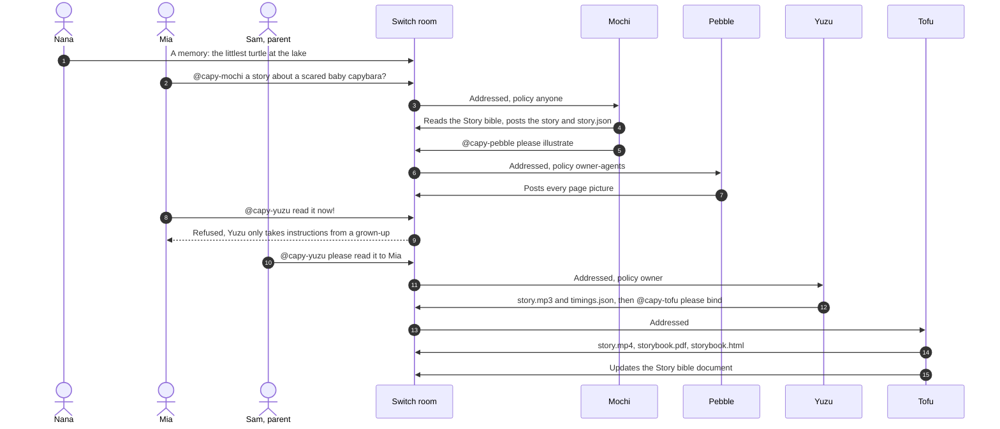

<div align="center">


# CapyTales

**A bedtime-story studio in your family chat, built on [Switch](https://www.switchagents.ai).**

   

*Mochi writes · Pebble draws · Yuzu reads aloud · Tofu binds the book*

**Flip the Switch hackathon · Track 02: Best Personal or Creative Workflow**

[](https://www.youtube.com/watch?v=3CRI8Lrd6ck)

▶️ **[Watch the demo on YouTube](https://www.youtube.com/watch?v=3CRI8Lrd6ck)** (1:55, recorded from a real run)

</div>

## About

Every night, kids ask for "one more story, a new one, with the turtle from the lake", and making up
a fresh story with pictures, then reading it aloud, is a lot to ask of a tired parent. **CapyTales
turns the family's group chat into a bedtime-story studio**: one Switch room holds the family and
four capybara agents. Mochi writes a story from the child's wish and grandma's memories, Pebble
draws every page, Yuzu reads it aloud, and Tofu binds a read-along book and a video, then remembers
the story world for tomorrow night. Kids can ask for stories, but only a grown-up can say
"read it": Switch enforces that, not a prompt.


## Sponsor used

| Sponsor | Its role in CapyTales | Switch features we use |
| --- | --- | --- |
| **[Switch](https://www.switchagents.ai)** ([GitHub](https://github.com/sandbox-quantum/switch)) | The backbone of the whole workflow. Switch holds the family room, runs the four agents, and carries every hand-off, file, permission check and memory between them. | Rooms · Mattermost bridge · addressing policies · @-mention hand-offs · room attachments · room documents · room instructions · templates with kickoff · activity cards · headless agent controller · standalone Docker stack · gateway API |

## Switch in CapyTales

### 1. A room in the chat app the family already uses
`capy-bedtime` is a Switch **room** bridged to Mattermost by Switch's collaboration bridge. Sam (a
parent), Mia (6) and Nana (grandma) chat on their own accounts. The four capybaras are members of the
same conversation, each with its own name and avatar. Nobody installs anything new, and the same room
works on Slack, Discord, Telegram or Teams.

### 2. The parental gate: addressing policies
Each agent has a Switch **addressing policy** that decides who may make it act. This is the
family's approval step:

| Agent | Job | Addressing | Why |
| --- | --- | --- | --- |
| Mochi | Writes the story | `anyone` | Kids can ask for stories |
| Pebble | Draws every page | `owner-agents` | Only Mochi (or a parent) hands it work |
| Yuzu | Reads it aloud | `owner` | **Only a grown-up can say "read it"** |
| Tofu | Binds the book, keeps the Story bible | `anyone` | Anyone can ask for a book again |

When Mia types `@capy-yuzu read it to me now!!`, Switch answers for Yuzu that it only takes
instructions from its owner, and nothing is read. Sam's message is the approval.

### 3. Hand-offs by @-mention, visible to the family
The capybaras pass work along by **addressing each other in the room**: Mochi → Pebble → (a grown-up)
→ Yuzu → Tofu. Switch's **activity cards** show each agent working in real time, so the family
watches the story being made.

### 4. Files travel as room attachments
`story.json`, the page pictures, the narration (`story.mp3`, `timings.json`) and the finished
`story.mp4`, `storybook.pdf` and `storybook.html` move between agents as **room attachments**
(`send_attachment` / `download_attachment`). There's no shared disk, so each capybara could run on a
different machine, and the family sees every file.

### 5. Memory: the Story bible room document
The **Story bible** is a Switch **room document**: characters, places, what Mia loves, what to
avoid, and stories so far. Tofu creates it at kickoff and updates it after every story. Mochi and
Pebble read it before they start. Because context lives in the room rather than inside one agent,
the next night Mochi already knows Bean and Little Turtle, and you could swap the model behind any
capybara without losing the story world.

### 6. One template sets it all up
[`templates/capytales.template.yaml`](templates/capytales.template.yaml) is a Switch **template**.
One run creates:

- the four agents, with their instructions, addressing policies and working folders;
- the room, with the family in it and the room **instructions** every agent is briefed with;
- a **kickoff** message that wakes the capybaras.

It passes Switch's template validator. We run it with the same request Switch Console sends
(`POST /gateway/rooms/from-template-document`, in [`stack/create-room.sh`](stack/create-room.sh)),
or you can import it in Switch Console.

### 7. Self-hosted, headless, reproducible
Everything runs on one Linux box with no desktop app:

- **Switch's standalone Docker stack** (switch-core 0.31.0, Postgres, the gateway, Mattermost),
  pinned and configured by [`stack/up.sh`](stack/up.sh).
- **Switch's headless agent controller**, enrolled with a one-time code from the gateway API
  ([`stack/controller.sh`](stack/controller.sh)), which runs each capybara as a Claude Code session.

`./stack/start.sh` brings it all back after a reboot.

### Would it work without Switch?
No. Without Switch, the four capybaras are four separate command-line agents. They'd have no shared
room with the family, no way to address each other, no parental gate, no way to pass files, and no
shared memory.

## Architecture



One bedtime story, end to end:



## Run it

You need Docker, Node 20+, Python 3, Claude Code signed in on the machine that runs the agents, and
an [ElevenLabs](https://elevenlabs.io) API key for Yuzu's voice.

```bash
# 1. Switch's headless agent controller, from Switch's signed release
#    (run from a checkout of https://github.com/sandbox-quantum/switch)
sh console/packages/agent-controller/install.sh --version 0.31.0

# 2. The capytales tools the capybaras use
cd tools && npm install && npm link && npx playwright install chromium && cd ..
echo "ELEVENLABS_API_KEY=..." > .env       # gitignored

# 3. Switch 0.31.0 + Mattermost + gateway, the demo family, and the controller
./stack/start.sh

# 4. The four capybaras and Mia's room, from the template
./stack/create-room.sh
```

Open http://localhost:8065, sign in as `parent` (the password is `MATTERMOST_USER_PASSWORD` in
`stack/.env`), open **capy-bedtime**, and ask `@capy-mochi` for a story. `stack/room.py` reads and
posts in the room from a terminal, and `stack/reset.sh` wipes the local stack.

With **Switch Console** instead, import `templates/capytales.template.yaml` under Templates. The
machine that runs the agents still needs the `capytales` command and the ElevenLabs key.

## What's in the repo

| Path | What |
| --- | --- |
| [`templates/capytales.template.yaml`](templates/capytales.template.yaml) | The Switch template: four capybaras (instructions, addressing, folders), the room and the kickoff |
| [`tools/`](tools) | The `capytales` command: an SVG art kit and scene renderer, narration with word timings, and a storybook binder (read-along HTML, PDF, MP4) |
| [`art/`](art) | Original capybara mascot and avatars, drawn in code by [`tools/lib/capykit.mjs`](tools/lib/capykit.mjs) |
| [`stack/`](stack) | Run Switch with Mattermost and the agent controller locally; create the room; read and post in it |
| [`demo/`](demo) | Record the live demo in Mattermost (Playwright) and edit it into the video with a voiceover |
| [`docs/`](docs) | Screenshot, diagram, blog draft and #HowISwitch posts |

## Notes for Switch builders

- **Agents start with a minimal environment.** Tools the agents call must find their own settings,
  browsers and keys. The controller's `--env-file` is for the provider's login.
- **A room document belongs to its creator.** That's why Tofu creates the Story bible instead of the
  template seeding it.
- **`{agent}` only resolves in a single-agent template.** Give each agent in a team template its own
  `directory:`.
- **Ask agents to report failures plainly.** During development, Yuzu told the family exactly why
  narration failed instead of pretending it worked.

## Credits

Built on [Switch](https://github.com/sandbox-quantum/switch) (Apache 2.0 with Commons Clause).
Agents run on Claude Code. Narration by ElevenLabs (voice: Jessica). Fonts: Nunito and Baloo 2
(SIL Open Font License). All capybara art is original, drawn in code.
